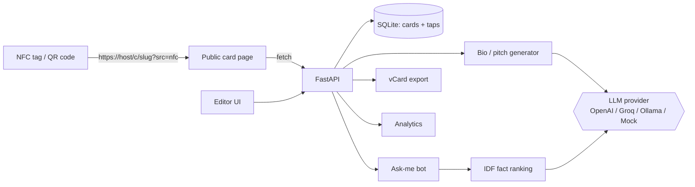
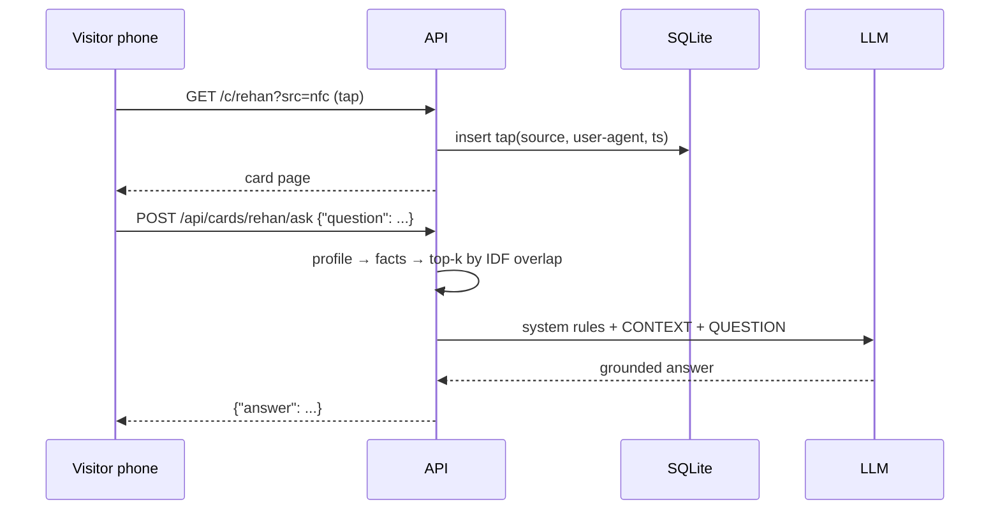

# Smart NFC Card — AI-powered digital business card

Tap an NFC tag (or scan a QR code) and your contact opens a live profile card: a short AI-written bio,
your skills and links, a **one-tap vCard download**, and an **"Ask me" chatbot** that answers visitors'
questions about you, using only what's in your profile. Every tap is logged, so you can see when and how people found you.

## Features

| Feature | How |
|---|---|
| Digital profile card | `POST /api/cards`, served publicly at `/c/<slug>` |
| NFC tag payload | `scripts/make_tag.py` builds an NFC Forum **NDEF URI record** (+ Type 2 TLV hex) |
| QR fallback | Same script, PNG QR code for phones without NFC |
| AI bio + elevator pitch | `POST /api/cards/<slug>/bio`, prompt limited to profile facts |
| Visitor "Ask me" bot | `POST /api/cards/<slug>/ask`, IDF-ranked profile facts → LLM |
| vCard 3.0 download | `GET /api/cards/<slug>/vcard` |
| Tap analytics | `GET /api/cards/<slug>/analytics`, broken down by source (nfc/qr/link), device and day |
| Pluggable LLM | `openai`, `groq`, `ollama` or an offline `mock` |

## Architecture





## Quickstart

```bash
python -m venv .venv && source .venv/bin/activate
pip install -r requirements-dev.txt
cp .env.example .env            # LLM_PROVIDER=mock works with no API key
uvicorn app.main:app --reload   # editor UI at http://localhost:8000/
```

Create a card and generate a bio:

```bash
curl -X POST localhost:8000/api/cards -H 'content-type: application/json' -d '{
  "slug":"rehan","full_name":"Rehan Khan","title":"AI/ML Engineer",
  "skills":["Python","LangChain","FastAPI"],"links":{"github":"https://github.com/ReXhXan"}}'
curl -X POST localhost:8000/api/cards/rehan/bio -H 'content-type: application/json' -d '{"tone":"friendly"}'
curl -X POST localhost:8000/api/cards/rehan/ask -H 'content-type: application/json' -d '{"question":"What does he work with?"}'
```

### Writing the NFC tag

```bash
python -m scripts.make_tag rehan --base-url https://your-domain.com --out out/
# out/rehan.ndef     -> import into "NFC Tools" (Android/iOS) and write to an NTAG213/215/216
# out/rehan.tlv.hex  -> raw Type 2 tag TLV for low-level writers
# out/rehan-qr.png   -> print on the back of the card
```

The tag URL carries `?src=nfc` and the QR carries `?src=qr`, which is how the analytics tell them apart.
The NDEF record uses the URI prefix abbreviation (`0x04` = `https://`), so the payload stays small enough for an NTAG213 (144 bytes).

### Docker

```bash
docker compose up --build
```

## Configuration (`.env`)

| Variable | Default | Notes |
|---|---|---|
| `LLM_PROVIDER` | `mock` | `openai` / `groq` / `ollama` / `mock` |
| `LLM_MODEL` | `llama3.1` | e.g. `gpt-4o-mini`, `llama-3.1-8b-instant` |
| `OPENAI_API_KEY`, `GROQ_API_KEY` | | only for those providers |
| `OLLAMA_BASE_URL` | `http://localhost:11434` | |
| `PUBLIC_BASE_URL` | `http://localhost:8000` | base of the URL written to the tag |
| `DATABASE_PATH` | `./data/cards.db` | SQLite file |

## Tests

```bash
pytest -q
```

The tests run fully offline. They use the deterministic `MockLLM`, in-memory SQLite and FastAPI's `TestClient`, and cover
NDEF byte layout (short and long records, TLV), vCard escaping, retrieval ranking, prompt grounding, tap analytics and every API route.

## Design decisions

- **Retrieval without a vector DB.** A profile is about 10 facts, so IDF-weighted keyword overlap is enough and costs nothing. Embeddings would add work without improving answers.
- **Grounded prompts.** Both the bio and the chatbot prompts allow only facts from the profile, and the bot is told to ignore instructions hidden in visitor questions.
- **The tag stores a URL, not data.** You can edit your card without rewriting the tag, and every tap can be counted.
- **Stdlib SQLite** keeps it to one file to deploy. Swapping in Postgres means rewriting only `app/db.py`.

## Roadmap

- Owner authentication (API keys or OAuth) for editing cards and viewing analytics
- Profile photo and themes
- Streaming chat responses
- Postgres + Alembic for multi-user hosting
